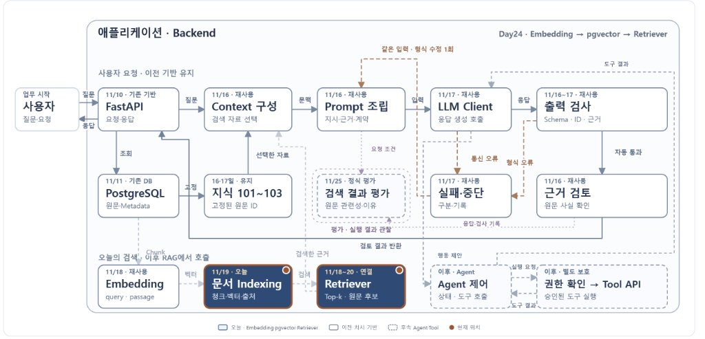

# basic 실습 요약 및 학습 정리 노트 (Day 24)

문서 원문을 수집해 파싱·정제·청킹·검증·메타데이터 결합을 거쳐 pgvector 인덱싱 준비까지 연결하는 8단계 데이터 인제스트(Ingest) 파이프라인 정리입니다.

---

## 1. 전체 아키텍처 및 오늘의 위치

전체 백엔드 흐름에서 오늘(11/19) 실습은 하단 **오늘의 검색 · 이후 RAG에서 호출** 영역의 **문서 Indexing (청크·벡터·출처)** 박스를 중심으로, 앞단 PostgreSQL (원문Metadata)에서 데이터를 꺼내 **Embedding (query · passage)** 및 Retriever (Top-k · 원문 후보)로 안전하게 넘기기 위한 전처리와 데이터 계약을 다룹니다.

---

## 2. 실습별 핵심 요약

| 실습 | 주제 | 핵심 내용 |
| :--- | :--- | :--- |
| **01** | 원문 수집 (`01_collection`) | 인코딩 변환 없이 원본 파일을 순수 바이트(`bytes`)로 읽어 무결성을 보존하고, `doc_id`·`size_bytes`·`raw_sha256` 해시를 기록 |
| **02** | 문서 파싱 (`02_parsing`) | `utf-8-sig` + `errors='strict'`로 엄격히 디코딩해 손상 바이트를 즉시 탐지하고, 페이지 개념이 없는 TXT는 가짜 `1` 대신 `page_number: None` 명시 |
| **03** | 문장 정제 (`03_cleaning`) | 일반 prose 전용 정제. CRLF를 먼저, CR을 나중에 LF로 통일하고 줄 단위(`split('\n')`)로 공백/탭만 축소해 문단 경계(빈 줄)를 보존 |
| **04** | 청킹 (`04_chunking`) | `0 <= overlap < size` 및 `type(...) is int` 검증 후 슬라이딩 윈도우 `[start, end)`로 분할하며, `end == len(text)`에서 즉시 종료해 꼬리 중복 청크 방지 |
| **05** | Span 검증 (`05_validation`) | `0 <= char_start < char_end <= len(text)` 경계와 `chunk['text'] == text[start:end]` 일치 여부, 공백 전용 빈 청크 여부를 검증해 인덱스 오염 차단 |
| **06** | 메타데이터 (`06_metadata`) | 청크에 `doc_id`·`source_version`·`category`·`source_locator`를 결합해 출처 추적성을 보장하고, 순서를 유지한 채 도메인(`category`) 필터링 수행 |
| **07** | pgvector 인덱싱 (`07_indexing`) | E5 본문 접두어(`passage: `) 입력을 검증하고, DB 검색 결과 행을 정수 `citation_id`(1 이상)와 `cosine_distance` 딕셔너리로 정규화 (`prepared_only_not_db` vs `--live-db`) |
| **08** | 종합 프로젝트 (`08_daily_project`) | `DOC-ASSIGN` 문서를 대상으로 파싱 -> 정제 -> 청킹(110/15) -> Span 검증을 단일 파이프라인으로 연결하고 `status: prepared_not_embedded` 리포트 생성 |

---

## 3. 실습 파일별 아키텍처 박스 매핑

| 실습 | 파일 경로 | 대응되는 이미지 박스 | 역할 설명 |
| :--- | :--- | :--- | :--- |
| **01** | `01_collection/main.py` | **PostgreSQL (원문·Metadata)** / **지식 101 - 103 (고정된 원문 ID)** | 원문 파일을 가공 없이 바이트 그대로 읽고, 파일명 대신 고정된 `doc_id`와 `raw_sha256` 지문을 부여해 원문 저장소의 출발점을 만듭니다. |
| **02** | `02_parsing/main.py` | **PostgreSQL (원문·Metadata)** -> **Chunk** 화살표 전단계 | 저장된 원문 바이트를 UTF-8로 디코딩하고, 이후 추적에 필요한 `source_version`, `unit_id`, `source_locator`가 포함된 `ParsedUnit`을 생성합니다. |
| **03** | `03_cleaning/main.py` | **문서 Indexing (청크·벡터·출처)** 내부 전처리 | 파싱된 원문(`raw_text`)이 청크로 분할되기 전, 불필요한 공백과 줄바꿈 차이를 정규화해 일관된 정제 본문을 만듭니다. |
| **04** | `04_chunking/main.py` | **PostgreSQL -> Embedding** 사이 **Chunk** 화살표 및 **문서 Indexing (청크)** | 정제 본문을 임베딩 모델과 검색에 적합한 크기(`size`, `overlap`)의 문자 창(`Chunk`)으로 분할합니다. |
| **05** | `05_validation/main.py` | **문서 Indexing (청크·벡터·출처)** 내부 무결성 게이트 | 생성된 청크의 `char_start`·`char_end`가 정제 본문 슬라이스와 1글자도 틀리지 않는지 검증해 잘못된 청크가 `Embedding`으로 넘어가지 않도록 차단합니다. |
| **06** | `06_metadata/main.py` | 문서 Indexing (청크·벡터·출처)의 **출처** & **PostgreSQL (Metadata)** | 청크에 `doc_id`, `category`, `source_locator`를 결합합니다. 이 메타데이터는 이후 **Retriever**의 필터링과 상단 **출력 검사 / 근거 검토**의 출처 확인에 사용됩니다. |
| **07** | `07_indexing/main.py` | **Embedding (query · passage)** -> **문서 Indexing (11/19 · 오늘)** -> **Retriever (11/18 - 20 · 연결)** | 청크에 E5 `passage: ` 접두어가 붙어 있는지 확인해 **Embedding** 입력 계약을 보장하고, pgvector 저장(**문서 Indexing**) 및 검색 결과 행 정규화(**Retriever**의 `Top-k · 원문 후보` 반환 계약)를 담당합니다. |
| **08** | `08_daily_project/main.py` | **PostgreSQL (원문·Metadata)** -> **문서 Indexing (11/19 · 오늘)** 직전 통합 흐름 | 원문 조회부터 파싱·정제·청킹·Span 검증까지 앞선 전처리 단계를 하나로 묶어, **문서 Indexing**에 투입 가능한 상태(`prepared_not_embedded`)임을 검증·보고합니다. |

---

## 4. 기억해야 할 5가지 핵심 원칙

1. **수집·파싱·정제·검증 책임을 섞지 않는다**
   - 수집(`01`)은 순수 바이트 무결성, 파싱(`02`)은 디코딩과 구조화, 정제(`03`)는 정규화만 담당해야 실패 지점("어느 단계에서 깨졌는가")을 즉시 특정할 수 있습니다.

2. **슬라이딩 윈도우 경계와 종료 조건을 엄격히 검증한다**
   - `bool`은 `int`의 하위 타입이므로 `type(x) is not int`로 차단해야 하며, `overlap < size` 검사와 `end == len(text)` 종료 조건이 없으면 무한 루프나 중복 꼬리 청크가 발생합니다.

3. **인덱싱 전 Span 무결성과 빈 청크를 반드시 걸러낸다**
   - `char_start`·`char_end` 오프셋이 원문 슬라이스와 어긋나면 검색 후 **근거 검토** 단계에서 원문 위치를 찾을 수 없게 됩니다.

4. **출처 메타데이터는 청크와 항상 함께 이동한다**
   - 본문만 벡터화하면 검색 결과(`Top-k`)가 어느 문서(`doc_id`), 어느 버전(`source_version`), 어느 위치(`source_locator`)에서 왔는지 증명할 수 없습니다.

5. **준비 완료와 실제 DB 적재 성공을 구분해 기록한다**
   - DB 미연결 상태에서 로컬 계약만 통과한 결과는 `prepared_only_not_db` / `prepared_not_embedded` / `not_run`으로 명시해야 하며, 실제 PostgreSQL 적재(`--live-db`) 성공으로 허위 기록하지 않습니다.
