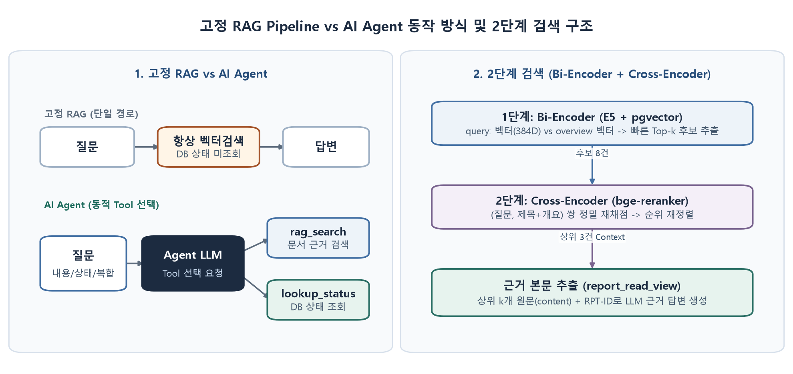
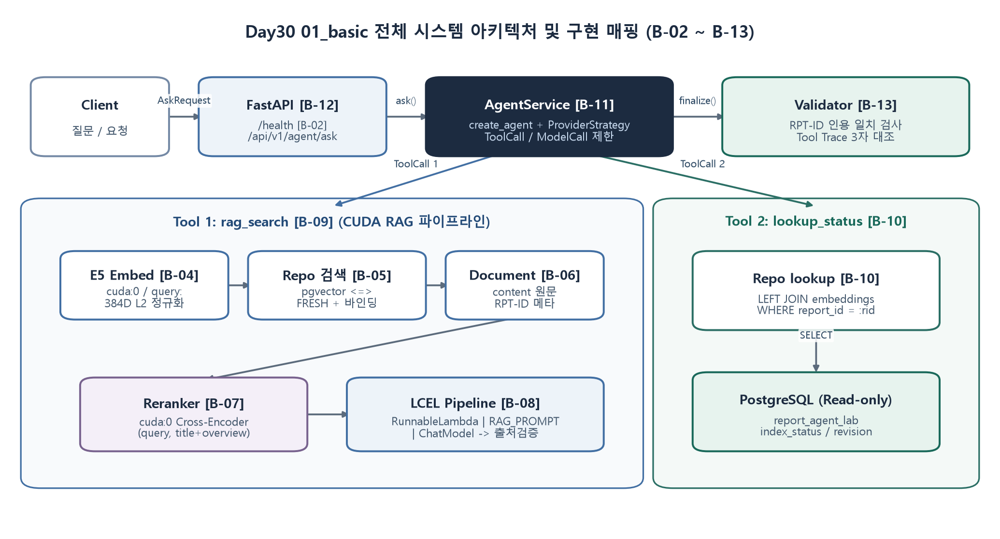

# LangChain 기반 AI Technical Report Agent (01_basic) 기초부터 결과까지 완벽 가이드

이 문서는 PostgreSQL(`pgvector`)과 LangChain Agent를 결합한 기술 보고서 질의응답 백엔드(`01_basic`)를 **기초 개념부터 실제 DB·GPU·LLM 연동 결과 해석, 그리고 토론 핵심 논점까지** 한눈에 이해할 수 있도록 정리한 설명서입니다.

---

## 1. 실습의 큰 그림: 우리는 무엇을 풀려고 하는가?

### 1-1. 단순 LLM과 고정 RAG의 한계를 넘는 AI Agent
- **단순 LLM**: 학습 당시의 일반 지식만 알고 있으므로, 사내 기술 보고서 내용이나 지금 이 순간 DB에 저장된 인덱싱 상태를 알 수 없습니다.
- **고정 RAG Pipeline**: 모든 질문에 무조건 `벡터 검색 -> 문서 읽기 -> 답변 생성` 순서만 밟습니다. 하지만 `"보고서 63번의 현재 인덱싱 상태와 revision이 뭐야?"`처럼 실시간 DB 컬럼을 묻는 질문에는 비정형 문서 본문만 뒤져서는 정확한 값을 답할 수 없습니다.
- **AI Agent**: 사용자의 질문을 읽고 **어떤 도구를 몇 번 호출할지 스스로 판단**합니다.
  - 보고서 내용 질문 -> `rag_search` 호출
  - DB 상태 질문 -> `lookup_status` 호출
  - 내용 + 상태 복합 질문 -> 두 도구를 모두 호출해 결과를 결합

### 1-2. 데이터셋 및 DB 구조 (`report_agent_lab`)
- **DB 엔진**: PostgreSQL 18 + `pgvector` `0.8.1`
- **데이터 규모**: 총 180건의 기술 보고서(`reports`)와 180건의 개요 임베딩(`report_embeddings`)
- **카테고리(6종)**: `DAILY_WORK`, `DATA_PROCESSING`, `EXPERIMENT`, `MEETING`, `PROMPT`, `RESEARCH_PLAN`
- **역할 분리**:
  - `reports.overview` + `report_embeddings.embedding`: 유사한 보고서를 빠르게 찾기 위한 384차원 검색 인덱스
  - `report_read_view.content`: 검색으로 뽑힌 보고서의 전체 본문(LLM이 실제로 읽고 답변을 작성하는 근거)

---

## 2. 기초 개념 1: 도구 호출(Tool Calling)과 서버 통제

많은 입문자가 "AI Agent가 DB를 조회한다"고 하면 LLM이 직접 SQL 쿼리를 짜서 DB에 접속한다고 오해합니다. 본 실습은 이를 엄격히 분리했습니다.

1. **LLM이 하는 일**: 질문을 해석해 `"lookup_status 도구를 report_id=63 인자로 불러줘"`라는 **요청 JSON(`AIMessage.tool_calls`)만 생성**합니다.
2. **Python 서버가 하는 일**:
   - Pydantic 스키마(`strict=True`, `extra='forbid'`)로 인자가 올바른지 검사합니다. (예: `report_id=0` 또는 문자열 차단)
   - 서버 내부에 미리 고정된 읽기 전용 SQL 템플릿에 바인딩 파라미터(`:rid`)만 넣어 실행합니다([app/db/repository.py](app/db/repository.py)).
   - 조회 결과를 `ToolMessage` 형태로 LLM에게 돌려줍니다.

이 구조 덕분에 LLM이 프롬프트 인젝션에 속더라도 `DROP TABLE`이나 임의의 테이블 조회를 실행할 수 없습니다.

---

## 3. 기초 개념 2: 2단계 GPU 검색 파이프라인 (Bi-Encoder + Cross-Encoder)

### 3-1. 1단계: Bi-Encoder로 빠르게 후보 추리기
- **모델**: `intfloat/multilingual-e5-small` (`cuda:0`, 384차원)
- **원리**: 질문 앞에 `"query: "` 접두어를 붙여 벡터로 바꾸고([app/rag/embeddings.py](app/rag/embeddings.py)), DB에 미리 `"passage: "`로 저장된 180개 보고서 벡터와 코사인 거리(`<=>`)를 비교해 상위 후보(`Top-k`)를 빠르게 가져옵니다.
- **최신성 조건(`FRESH`)**: DB에 벡터가 있더라도 `index_status='ready'`, 동일 모델명, 384차원, `indexed_revision = revision`, `overview_hash` 일치 조건을 모두 만족할 때만 유효 후보로 인정합니다.

### 3-2. 2단계: Cross-Encoder로 정밀 재정렬하기
- **모델**: `BAAI/bge-reranker-v2-m3` (`cuda:0`)
- **원리**: 1단계에서 추린 소수 후보에 대해 `(질문, 보고서 제목 + 개요)` 쌍을 모델에 함께 입력하여 문맥적 관련성 점수를 정밀하게 다시 매깁니다([app/rag/reranker.py](app/rag/reranker.py)).
- **왜 2단계로 나누는가?**: Cross-Encoder는 정확도가 높지만 180건(실무에서는 수백만 건) 전체를 일일이 비교하면 너무 느립니다. 따라서 Bi-Encoder로 후보를 좁힌 뒤 Cross-Encoder로 순위를 다듬는 것이 실무 표준입니다.

---

## 4. 기초 개념 3: 출력 계약과 서버 검증기 (`Validator`)

LLM은 확률적으로 문장을 생성하므로, 아무리 프롬프트로 지시해도 출처 ID를 빼먹거나 없는 보고서 번호를 지어낼 수 있습니다. 이를 막기 위해 이중 방어선을 구축했습니다.

1. **구조화 출력 강제 (`ProviderStrategy(ModelAnswer)`)**:
   - [app/agent.py](app/agent.py)에서 최종 응답이 `status`, `answer`, `source_ids` 3개 필드만 갖도록 스키마를 강제합니다.
2. **서버 3자 대조 (`[app/services/validator.py](app/services/validator.py)`)**:
   - 본문(`answer`) 안에 적힌 `[RPT-번호]` 집합
   - JSON 배열(`source_ids`)에 담긴 출처 집합
   - 실제로 Tool이 DB에서 찾아와 LLM에게 전달한 `allowed` 집합
   - 위 세 가지가 정확히 일치하지 않으면 서버가 `OUTPUT_CONTRACT_ERROR`를 발생시켜 응답을 차단합니다.

---

## 5. 실측 검증 결과와 해석

### 5-1. 오프라인 계약 테스트 (`pytest`)
- `pytest tests/ -q -ra` 실행 결과 **41개 테스트 전체 통과**(`41 passed in 2.43s`)를 확인했습니다.
- 단, 이는 미리 준비된 Stub/Fixture 기반이므로 실제 DB·GPU·LLM 연동 성공을 대체하지 않습니다.

### 5-2. 실제 DB·GPU·LLM 연동 결과 (`scripts.preflight` & `scripts.verify_live`)
PostgreSQL 18에 `report_agent_lab`을 구축하고 180건 임베딩을 완료한 뒤, 실제 OpenAI API를 연결해 검증했습니다.

1. **`gpt-4o-mini` vs `gpt-4.1-mini` 비교**:
   - `gpt-4o-mini`에서는 JSON 형식 누락(`invalid_model_json`)과 인용 불일치(`rag_citation`)로 5개 LLM 시나리오 중 3개가 실패했습니다.
   - `gpt-4.1-mini`로 전환하고 [app/schemas/agent.py](app/schemas/agent.py)의 각 필드에 `Field(description=...)` 설명을 보완하자, **14개 전체 점검 중 13건 통과(`observed`)**, DB 무결성(`T-02-unchanged`) `equal: true`를 달성했습니다.
2. **유일한 실패 1건(`T-07/T-09/T-10-both`)의 정체**:
   - 실패한 1건은 DB나 GPU 오류가 아니라, 모델이 `source_ids`에 `RPT-63`을 넣고도 본문에는 `[RPT-63]` 대신 `보고서 63`으로만 작성했을 때 **서버 측 `Validator`가 출처 계약 위반을 의도적으로 차단한 결과**입니다.

---

## 6. 토론을 위한 핵심 논점 및 예상 Q&A

### 논점 1. 왜 모델이 틀렸을 때 자동으로 `[RPT-63]`을 붙여주지 않고 차단(Fail-Closed)하는가?
- **이유**: 서버가 임의로 문자열을 수정해 출처를 덧붙이면, 모델이 실제로 어떤 근거 문장을 보고 답했는지 추적할 수 없게 됩니다. 특히 잘못된 보고서 번호를 매칭할 위험이 있으므로, 교육 및 감사 관점에서는 계약 위반 시 즉시 차단해 원인을 드러내는 설계가 안전합니다.

### 논점 2. `gpt-4o-mini`에서 실패가 많았던 이유와 실무 모델 선택 기준
- **이유**: 본 실습은 단순 자연어 대화가 아니라 "Tool 호출 판단 + Structured Output JSON + 본문 내 `[RPT-번호]` 정규식 일치"를 동시에 요구합니다. 경량 모델은 지시사항이 겹칠 때 세부 서식 제약을 놓치기 쉬우므로, 엄격한 계약 기반 Agent에는 최소 `gpt-4.1-mini`급 이상의 지시 이행 능력이 필요합니다.

### 논점 3. 예상 Q&A 요약
- **Q. 왜 GPU(`cuda:0`)가 없으면 실행 자체를 막나요?**
  - A. `intfloat/multilingual-e5-small`과 특히 무거운 Cross-Encoder(`BAAI/bge-reranker-v2-m3`)는 CPU에서 실행 시 응답 지연이 수십 초까지 급증합니다. 실습 환경의 하드웨어 제약을 초기에 감지하기 위해 `require_cuda()`로 CPU fallback을 차단했습니다.
- **Q. `missing`과 `no_answer` 모두 `insufficient_evidence`로 나오는 이유는 무엇인가요?**
  - A. 존재하지 않는 보고서 번호(`999999`)를 조회한 경우(`missing`)와 사내 DB와 전혀 무관한 질문("화성의 낙타 미용실")을 한 경우(`no_answer`) 모두 답할 근거가 없기는 마찬가지입니다. AI가 아는 척 지어내는 환각(Hallucination)을 막고 일관된 거절 상태를 반환하기 위함입니다.
