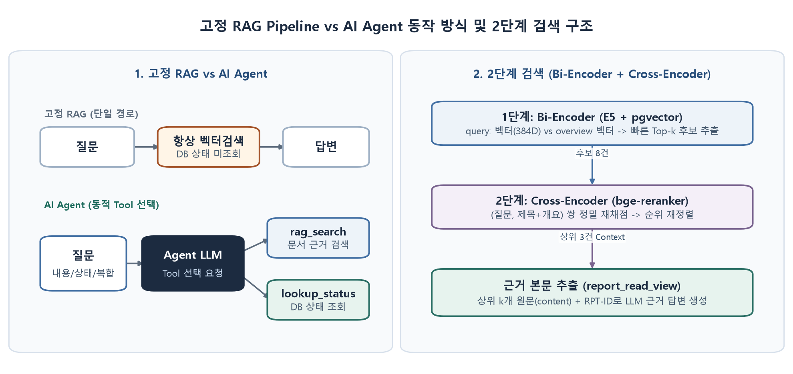
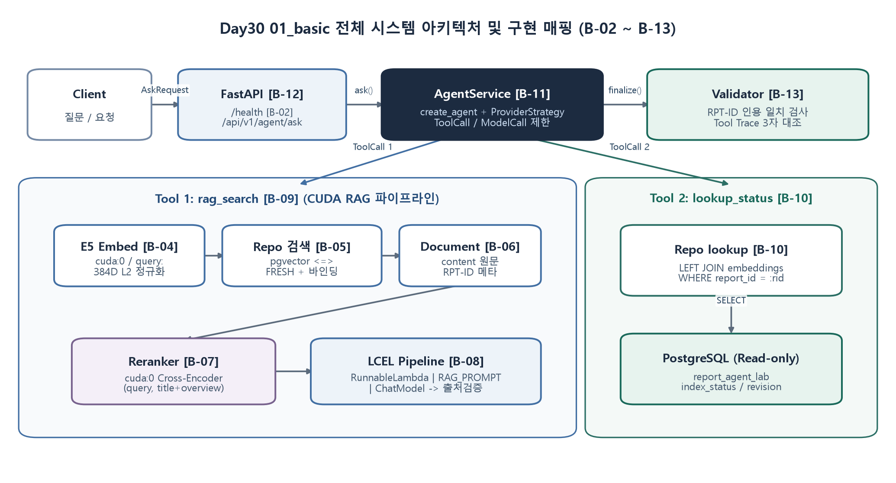

# LangChain 기반 AI Technical Report Agent (01_basic) 기술 분석 및 실측 검증 보고서

---

## 1. 프로젝트 및 과제 개요

### 1-1. 출제자 의도 및 핵심 요구사항 분석
본 프로젝트는 사내 기술 보고서 데이터베이스(`report_agent_lab`)를 기반으로 비정형 본문 검색(RAG)과 실시간 정형 DB 상태 조회를 통합 수행하는 **LangChain 기반 AI Agent 백엔드**(`01_basic`) 구축을 목표로 합니다. 요구사항 명세 및 계약 테스트가 요구하는 핵심 원칙은 다음과 같습니다.

1. **도구 호출과 서버 통제의 엄격한 분리**:
   - LLM이 `rag_search` 또는 `lookup_status` 호출을 결정하더라도 모델이 직접 DB에 접속하거나 SQL을 실행하지 않습니다.
   - Python 백엔드가 고정 SQL 템플릿과 바인딩 파라미터(`:vec`, `:cat`, `:rid`, `:k`, `:model`)로 읽기 전용 `SELECT`만 수행해 SQL 인젝션과 임의 DB 변경을 차단합니다.
2. **2단계 GPU 검색 파이프라인과 최신성(`FRESH`) 보장**:
   - Bi-Encoder(`intfloat/multilingual-e5-small`)와 `pgvector` 코사인 거리(`<=>`)로 후보를 추출한 뒤, Cross-Encoder(`BAAI/bge-reranker-v2-m3`)로 정밀 재정렬합니다.
   - `index_status='ready'`, 동일 모델명, 384차원, `indexed_revision = revision`, `overview_hash = sha256(overview)`를 모두 만족하는 최신 벡터만 검색 후보로 인정합니다.
3. **Zero-Trust 출력 검증 및 Fail-Closed 원칙**:
   - Agent의 최종 응답은 `ProviderStrategy(ModelAnswer)`로 구조화 출력을 강제하며, 서버 측 `Validator`가 본문의 `[RPT-번호]` 인용, `source_ids` 배열, 실제 Tool 실행 이력(`allowed` 집합)을 3자 대조합니다.
   - 계약과 어긋난 응답은 보정 없이 `OUTPUT_CONTRACT_ERROR`로 즉시 차단합니다.
4. **오프라인 검증과 실측(Live) 검증의 명확한 분리**:
   - Stub/Fixture 기반 `pytest` 통과와 실제 PostgreSQL + CUDA GPU + OpenAI API 실측 결과를 구분해 기록합니다.

### 1-2. 데이터베이스 및 모델 환경 요약
- **DB 환경**: PostgreSQL 18 (`report_agent_lab`, `pgvector` `0.8.1`)
- **적재 데이터**: `reports` 180건 (`report_embeddings` 180건 전체 색인 완료, `eligible_vectors: 180`), 6개 카테고리 (`DAILY_WORK`, `DATA_PROCESSING`, `EXPERIMENT`, `MEETING`, `PROMPT`, `RESEARCH_PLAN`)
- **GPU 연산 환경**: `cuda:0` (`NVIDIA GeForce RTX 4080 Laptop GPU`, CPU fallback 금지)
- **임베딩 / 재정렬 모델**: `intfloat/multilingual-e5-small` (384차원) / `BAAI/bge-reranker-v2-m3` (`max_length=512`, `batch_size=2`)
- **Agent LLM**: `gpt-4.1-mini` (초기 `gpt-4o-mini` 실측 비교 후 전환)

---

## 2. 시스템 아키텍처 및 구현 과정 (`B-02`에서 `B-13`)



### 2-1. 모듈형 백엔드 구조 (`app/`)
```text
01_basic/
├── app/
│   ├── core/preflight.py        # [B-02] DB, pgvector, CUDA, LLM 설정 사전 점검
│   ├── db/repository.py         # [B-05, B-10] pgvector 후보 조회 및 읽기 전용 상태 조회
│   ├── rag/
│   │   ├── embeddings.py        # [B-04] E5 query: 접두어 + L2 정규화 임베딩
│   │   ├── documents.py         # [B-06] Document 매핑 및 RPT-ID 메타데이터 보존
│   │   ├── reranker.py          # [B-07] Cross-Encoder 점수 계산 및 내림차순 재정렬
│   │   └── pipeline.py          # [B-08] LCEL 기반 RAG_PROMPT | model 체인 실행
│   ├── tools/
│   │   ├── rag_tool.py          # [B-09] rag_search Tool 래퍼 및 출력 계약 검증
│   │   └── db_tool.py           # lookup_status Tool 래퍼
│   ├── schemas/agent.py         # AskRequest, AskResponse, ModelAnswer 스키마
│   ├── services/validator.py    # [B-13] RPT-ID 인용 일치 및 Tool Trace 3자 검증
│   ├── agent.py                 # [B-11] create_agent + 호출 제한 미들웨어 + ProviderStrategy
│   └── api/agent.py             # [B-12] FastAPI /api/v1/agent/ask 엔드포인트
├── scripts/
│   ├── preflight.py             # 환경 준비 상태 점검 CLI
│   └── verify_live.py           # T-01에서 T-10 실측 검증 CLI
├── outputs/live_checks.json     # 실측 검증 원시 결과
└── reports/review.md            # 실습 요약 리뷰
```



### 2-2. 핵심 구현 및 실환경 보완 내역
1. **사전 점검 (`[app/core/preflight.py](app/core/preflight.py)`)**:
   - `repo.preflight()`로 DB 연결, `pgvector` 확장, 6개 카테고리, `eligible_vectors >= 1`을 검증하고 `require_cuda()`로 `cuda:0` 사용 가능 여부를 확인합니다.
2. **RAG 검색 및 재정렬 (`[app/rag/embeddings.py](app/rag/embeddings.py)`, `[app/db/repository.py](app/db/repository.py)`, `[app/rag/reranker.py](app/rag/reranker.py)`, `[app/rag/pipeline.py](app/rag/pipeline.py)`)**:
   - 질문에 `"query: "` 접두어를 붙여 384차원 정규화 벡터를 생성한 뒤 `OPERATOR(public.<=>)`로 코사인 거리 Top-k를 조회합니다.
   - `(query, title + overview)` 쌍을 Cross-Encoder로 재정렬하고, `RunnableLambda | RAG_PROMPT | model` LCEL 체인으로 근거 기반 답변을 생성합니다.
3. **DB 상태 조회 (`[app/db/repository.py](app/db/repository.py)`)**:
   - `reports`, `report_categories`를 `JOIN`하고 `report_embeddings`를 `LEFT JOIN`해 벡터 미생성 보고서도 `index_status`, `revision`, `embedding_fresh`를 조회할 수 있도록 구현했습니다.
4. **Structured Output 및 프롬프트 보완 (`[app/agent.py](app/agent.py)`, `[app/schemas/agent.py](app/schemas/agent.py)`)**:
   - 실측 과정에서 모델이 `source_ids`에는 `RPT-63`을 넣고 본문에는 `보고서 63`으로만 작성해 계약이 깨지는 현상을 관찰했습니다.
   - 이를 완화하기 위해 `ModelAnswer`의 `answer`, `source_ids` 필드에 `Field(description=...)`을 명시하고 `SYSTEM` 프롬프트의 `[RPT-번호]` 본문 표기 지침을 구체화했습니다.

---

## 3. 오프라인 및 실측 검증 결과

### 3-1. 오프라인 단위·계약·HTTP·SQL 테스트 (`pytest tests/ -q -ra`)
- **결과**: **41 passed in 2.43s** (`c:\Projects\Workspace\.backendenv\Scripts\python.exe`)
  - [tests/test_contracts.py](tests/test_contracts.py) (19개): 잘못된 `report_id` 차단, 메시지-실행 짝짓기, 가짜 출처 및 호출 상한 검증
  - [tests/test_framework.py](tests/test_framework.py) (11개): Document 매핑, Rerank 순서, Tool 스키마 차단, `ProviderStrategy` 구조화 응답
  - [tests/test_http_contract.py](tests/test_http_contract.py) (9개): `/health`, `/api/v1/agent/ask` 200/422 응답 및 장애 코드별 HTTP 500/503/504 매핑
  - [tests/test_sql_contract.py](tests/test_sql_contract.py) (2개): `FRESH` 조건, `OPERATOR(public.<=>)`, 파라미터 바인딩 검증

### 3-2. 사전 점검 (`python -m scripts.preflight`) 실측 결과
```json
{
  "db": "ready",
  "database": "report_agent_lab",
  "pgvector": "0.8.1",
  "categories": [
    "DAILY_WORK",
    "DATA_PROCESSING",
    "EXPERIMENT",
    "MEETING",
    "PROMPT",
    "RESEARCH_PLAN"
  ],
  "eligible_vectors": 180,
  "gpu": "cuda:0",
  "embedding_model": "intfloat/multilingual-e5-small",
  "reranker_model": "BAAI/bge-reranker-v2-m3",
  "llm": "configured",
  "llm_live_verified": false
}
```

### 3-3. 실측 검증 (`python -m scripts.verify_live --allow-paid-llm`) 비교
- **1차 실측 (`gpt-4o-mini`)**:
  - `db_only`, `missing`은 통과했으나, `rag_only`(`rag_citation`), `both`(`rag_citation`), `no_answer`(`invalid_model_json`) 3건에서 `OUTPUT_CONTRACT_ERROR`가 발생했습니다.
- **2차 실측 (`gpt-4.1-mini` 전환 및 스키마·프롬프트 보완 후)**:
  - 총 14개 점검 항목 중 **13건 `observed` 통과**, **1건 `failed`**, DB 스냅샷 무결성(`T-02-unchanged`) `equal: true`를 확인했습니다([outputs/live_checks.json](outputs/live_checks.json)).

| 점검 항목 | 상태 | 응답 상태 / 오류 | 실측 시간 (`latency_ms`) | 토큰 사용량 |
| :--- | :---: | :--- | :---: | :---: |
| `T-01`, `T-02-before`, `T-01-test-ids` | `observed` | DB·테스트 ID(`63`, `999999`) 준비 확인 | - | - |
| `T-03-vector` | `observed` | `cuda:0` 임베딩 모델 로드 및 384차원 정규화 | 10943.77 | - |
| `T-03/T-05` | `observed` | `pgvector` 검색 + Cross-Encoder 재정렬 | 5681.85 | - |
| `T-06-lookup` | `observed` | `found` (`ready`, `revision=1`, `fresh=true`) | - | - |
| `T-04/T-06-rag` | `observed` | `found` (직접 RAG Tool 검증) | 2202.38 | 724 |
| `T-07/T-09/T-10-rag_only` | `observed` | `completed` (`[RPT-63]` 인용 포함) | 4725.82 | 3178 |
| `T-07/T-09/T-10-db_only` | `observed` | `completed` (`index_status=ready, revision=1`) | 1710.34 | 2127 |
| `T-07/T-09/T-10-both` | `failed` | `OUTPUT_CONTRACT_ERROR` (`agent_citation`, 의도적 차단) | - | - |
| `T-07/T-09/T-10-no_answer` | `observed` | `insufficient_evidence` | 3206.89 | 3143 |
| `T-07/T-09/T-10-missing` | `observed` | `insufficient_evidence` | 1638.76 | 2116 |
| `T-02-after`, `T-02-unchanged` | `observed` | `equal: true` (DB 변경 없음) | - | - |

---

## 4. 오차·실패 진단 및 아키텍처 고찰

### 4-1. 실패 1건(`T-07/T-09/T-10-both`)의 의미: 서버 검증기의 의도적 차단
- `T-07/T-09/T-10-both` 실패는 PostgreSQL 연결, GPU(`cuda:0`) 연산, Tool 실행, OpenAI API 연동의 결함이 아닙니다.
- `both` 질의("보고서 63의 핵심 내용과 인덱싱 상태를 함께 설명해 줘.")에서 `rag_search`와 `lookup_status`가 모두 정상 호출되었으나, LLM이 `source_ids`에는 `["RPT-63"]`을 채우고 `answer` 본문에는 `[RPT-63]` 대신 `보고서 63`으로만 서술했습니다.
- 이때 **서버 측 출력 검증기**(`Validator`)가 본문 인용 집합과 `source_ids` 집합의 불일치를 감지하고, 불완전한 응답을 그대로 반환하지 않기 위해 `OUTPUT_CONTRACT_ERROR`(`agent_citation`)로 **의도적으로 차단**했습니다.

### 4-2. 실무 운영 관점의 개선 방향
1. **자기 교정(Self-Correction) 재시도 계층 도입**:
   - 현재는 `agent_citation` 위반 시 즉시 500 오류(`OUTPUT_CONTRACT_ERROR`)를 반환합니다. 실서비스에서는 `Validator`가 오류 사유(`본문에 [RPT-63] 표기가 누락됨`)를 모델에 1회 피드백해 재생성을 유도하면, 엄격한 출처 계약을 유지하면서도 복합 질의 성공률을 높일 수 있습니다.
2. **모델 등급 및 비용 트레이드오프**:
   - 경량 모델(`gpt-4o-mini`)은 JSON/인용 규칙 준수율이 낮아 5개 시나리오 중 3건이 차단되었습니다. 엄격한 Structured Output과 다중 도구 결합이 필요한 워크플로우에서는 최소 `gpt-4.1-mini` 이상 모델을 기본값으로 채택하는 것이 안정적입니다.
