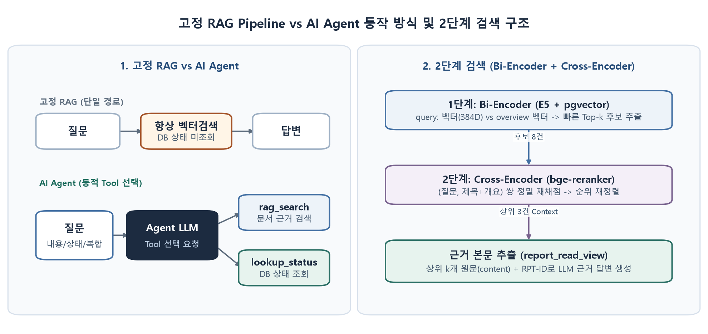
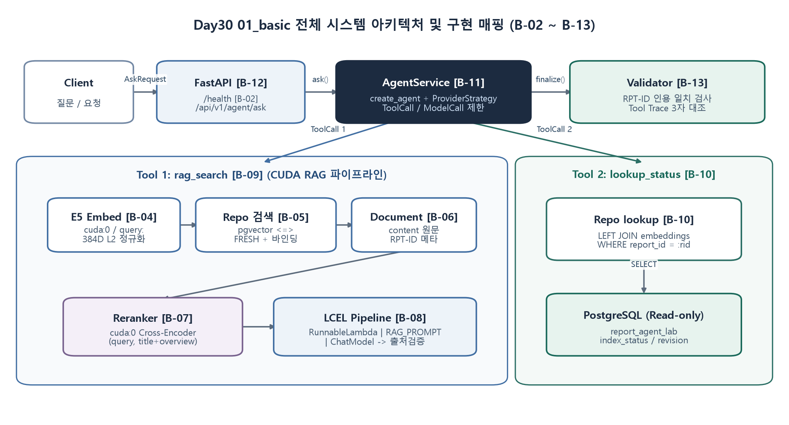

# Day30 · 01_basic · LangChain 기반 AI Technical Report Agent 상세 보고서

## 1. 핵심 개념 기초 설명



### 1.1 왜 단순 LLM이나 고정 RAG 대신 AI Agent를 쓰는가?
- **단순 LLM**: 학습된 지식만으로 답하므로 사내 기술 보고서 내용이나 실시간 DB 상태를 알 수 없습니다.
- **고정 RAG Pipeline**: 모든 질문에 무조건 "벡터 검색 -> 문서 읽기 -> 답변 생성" 순서로만 동작합니다. 하지만 `"보고서 63번의 현재 인덱싱 상태는?"`처럼 실시간 DB 컬럼(`index_status`, `revision`)을 물으면 비정형 문서 검색만으로는 답할 수 없습니다.
- **AI Agent**: 사용자의 자연어 질문을 보고 LLM이 **어떤 도구(Tool)를 몇 번 호출할지 스스로 선택**합니다.
  - 문서 내용 질문 -> `rag_search` 호출
  - DB 상태 질문 -> `lookup_status` 호출
  - 복합 질문 -> `rag_search`와 `lookup_status`를 모두 호출해 결과를 결합

### 1.2 Tool Calling과 서버 통제의 분리
- LLM이 `rag_search` 또는 `lookup_status`를 호출하겠다고 결정하더라도, **모델이 직접 DB에 접속하거나 SQL을 실행하지는 않습니다.**
- 모델은 단지 **어떤 도구를 어떤 인자(JSON)로 불러달라**는 요청(`AIMessage.tool_calls`)만 생성합니다.
- 실제 DB `SELECT`, GPU 임베딩 계산, 예외 처리, 결과 검증은 Python 백엔드 서버가 수행하고, 그 결과를 `ToolMessage`로 모델에게 돌려줍니다.

### 1.3 Bi-Encoder(검색) vs Cross-Encoder(재정렬)
- **Bi-Encoder** (`intfloat/multilingual-e5-small`): 질문(`query: ...`)과 보고서 개요(`passage: ...`)를 각각 384차원 벡터로 변환한 뒤 `pgvector`의 코사인 거리(`<=>`)로 빠르게 후보(`Top-k`)를 추립니다.
- **Cross-Encoder** (`BAAI/bge-reranker-v2-m3`): 추려진 소수 후보의 `(질문, 제목 + 개요)` 쌍을 모델에 함께 입력해 문맥적 관련성 점수를 정밀하게 다시 매깁니다.

### 1.4 Report-level RAG와 데이터 역할 분리
- **`reports.overview` + `report_embeddings.embedding`**: 검색 후보를 찾기 위한 대표 텍스트와 384차원 벡터입니다.
- **`report_read_view.content`**: 검색이 끝난 뒤 LLM이 실제로 읽고 답변 근거로 삼는 보고서 본문입니다.
- **벡터 최신성(`FRESH`)**: DB에 벡터 행이 있더라도 `index_status='ready'`, 동일 모델명, 384차원, `indexed_revision = revision`, `overview_hash = sha256(overview)` 조건을 모두 만족할 때만 유효 후보로 인정합니다.

---

## 2. 전체 시스템 아키텍처 흐름



```text
사용자(Client)
  └─> FastAPI (/api/v1/agent/ask) [B-12]
        └─> AgentService.ask (create_agent + ProviderStrategy) [B-11]
              ├─> Tool 1: rag_search [B-09]
              │     ├─> CUDA E5 Query Embedding (query: + L2 정규화) [B-04]
              │     ├─> PostgreSQL pgvector 후보 조회 (FRESH + <=> 거리순) [B-05]
              │     ├─> Document 변환 (본문 + RPT-ID 메타데이터) [B-06]
              │     ├─> CUDA Cross-Encoder Reranking [B-07]
              │     └─> RunnableLambda | RAG_PROMPT | ChatModel [B-08]
              └─> Tool 2: lookup_status
                    └─> PostgreSQL Read-only 상태 조회 (LEFT JOIN) [B-10]
              └─> Validator (인용 RPT-ID 검증 + Tool Trace 3자 대조) [B-13]
```

### 구현 요약: 무엇을, 왜, 어떻게 동작하는가?
- **무엇을 구현했는가**: 기존 `report_agent_lab` DB를 읽기 전용으로 조회하는 2개의 도구(`rag_search`, `lookup_status`)와 이를 자율적으로 호출하는 LangChain `create_agent` 기반 FastAPI 백엔드(`B-02`에서 `B-13`)를 구현했습니다.
- **무엇을 위해서 구현했는가**: 문서 내용 검색(비정형 본문)과 보고서 인덱싱 상태 확인(정형 DB 컬럼)이라는 서로 다른 정보원을 하나의 자연어 질의 안에서 안전하게 통합하고, 출처 위조와 임의 SQL 실행을 코드 수준에서 차단하기 위함입니다.
- **어떻게 돌아가는가**:
  1. 요청이 들어오면 FastAPI(`[B-12]`)가 `preflight(`[B-02]`)`로 DB·CUDA·LLM 설정을 확인한 뒤 `AgentService(`[B-11]`)`에 질문을 넘깁니다.
  2. Agent LLM은 질문 성격에 따라 `rag_search(`[B-09]`)` 또는 `lookup_status(`[B-10]`)` 호출을 요청하고, 실제 서버가 GPU 검색·재정렬(`[B-04]`-`[B-08]`)이나 DB `SELECT`를 실행해 결과를 `ToolMessage`로 돌려줍니다.
  3. 마지막으로 `Validator(`[B-13]`)`가 모델의 최종 응답 속 `RPT-번호` 인용과 실제 Tool 실행 기록을 대조한 뒤 검증된 JSON을 반환합니다.

---

## 3. 단계별 구현 상세 (`11개 TODO`)

### 3.1 사전 점검 (Preflight)
- **B-02** ([app/core/preflight.py](../app/core/preflight.py))
  - `repo.preflight()`로 DB 이름(`report_agent_lab`), `pgvector` 확장, 6종 카테고리, 유효 벡터 수(`eligible_vectors >= 1`)를 확인합니다.
  - `require_cuda()`로 `cuda:0` GPU 사용 가능 여부를 검사해 CPU fallback을 원천 차단하고, LLM 설정 여부를 합쳐 `/health` 상태 딕셔너리를 반환합니다.

### 3.2 RAG 검색 및 재정렬 파이프라인
- **B-04** ([app/rag/embeddings.py](../app/rag/embeddings.py))
  - E5 모델 규격에 맞춰 입력 문자열 앞에 `"query: "` 접두어를 붙이고, 코사인 유사도 비교를 위해 `normalize_embeddings=True`로 L2 정규화한 뒤 Python `list`로 변환합니다.
- **B-05** ([app/db/repository.py](../app/db/repository.py) `candidates`)
  - `JOIN`과 `FRESH` 조건을 고정 SQL 템플릿으로 사용하고, 사용자 입력은 모두 바인딩 파라미터(`:vec`, `:cat`, `:rid`, `:k`, `:model`)로만 전달해 SQL 인젝션을 차단합니다.
  - `OPERATOR(public.<=>)`로 코사인 거리를 계산해 거리 오름차순 `TOP-k`를 조회합니다.
- **B-06** ([app/rag/documents.py](../app/rag/documents.py))
  - 조회된 행의 본문(`content`)을 LangChain `Document.page_content`에 담고, `source_id` (`RPT-번호`), `report_id`, `title`, `category_code`, `revision`, `overview`, `distance`를 `metadata`에 보존합니다.
- **B-07** ([app/rag/reranker.py](../app/rag/reranker.py))
  - `(query, title + overview)` 쌍 목록을 만들어 `cuda:0` Cross-Encoder의 `predict(..., batch_size=..., show_progress_bar=False)`를 실행합니다.
  - 결과 점수의 내림차순, 동점 시 `report_id` 오름차순으로 후보 순위를 재정렬합니다.
- **B-08** ([app/rag/pipeline.py](../app/rag/pipeline.py))
  - `RunnableLambda`로 `prepared` 딕셔너리에서 `question`, `query`, `context`만 추출해 `RAG_PROMPT | model` LCEL 체인으로 연결하고 `AIMessage` 응답을 받습니다.
- **B-09** ([app/tools/rag_tool.py](../app/tools/rag_tool.py))
  - Pydantic으로 검증된 인자(`query`, `effective_category`, `args.k`)를 `pipeline.run(...)`에 전달하고, `check_tool_output('rag_search', raw)`로 Tool 반환 계약(`found`/`not_found`와 `sources` 일치)을 검증합니다.

### 3.3 DB 상태 조회 Tool
- **B-10** ([app/db/repository.py](../app/db/repository.py) `lookup`)
  - `reports`와 `report_categories`를 `JOIN`하고 `report_embeddings`를 `LEFT JOIN`해, 벡터가 아직 없는 보고서라도 기본 상태(`index_status`, `revision`)를 조회할 수 있도록 구현했습니다.
  - `COALESCE(FRESH, false)`로 벡터 최신성(`embedding_fresh`)을 별도 불리언 필드로 반환하며, 행이 없으면 `not_found`를 돌려줍니다.

### 3.4 Agent 오케스트레이션 · 검증 · FastAPI 연결
- **B-11** ([app/agent.py](../app/agent.py))
  - `create_agent`에 모델, Tool 2개(`rag_search`, `lookup_status`), 시스템 프롬프트, 호출 제한 미들웨어(`ToolCallLimitMiddleware`, `ModelCallLimitMiddleware`, `measure_model`)를 연결했습니다.
  - `response_format=ProviderStrategy(ModelAnswer)`를 지정해 모델의 최종 응답을 네이티브 Structured Output으로 검증하고, `recursion_limit`을 유한하게 설정해 무한 루프를 방지합니다.
- **B-13** ([app/services/validator.py](../app/services/validator.py))
  - `citation_ids(answer, allowed)`에서 정규식 `RPT-\d+`로 본문 인용 ID를 추출한 뒤, `source_ids` 배열에 중복이 없고 본문 인용 집합과 일치하며 실제 Context에 포함된 `allowed` 집합의 부분집합인지 검사합니다.
- **B-12** ([app/api/agent.py](../app/api/agent.py))
  - `/api/v1/agent/ask` 요청 시 `runtime.health()` 확인 후 요청 단위 `request_id`와 `Meter`를 생성해 `runtime.agent.ask(request_id, body, meter)` 결과를 `AskResponse` 형식으로 반환합니다.

---

## 4. 검증 결과 및 현재 한계

### 4.1 오프라인 단위·계약·HTTP·SQL 테스트 (`pytest tests/ -v --tb=no`)
총 **41개 테스트 전체 통과** (`41 passed in 3.51s`, Python 3.12.16 / `.backendenv`)

| 테스트 파일 | 통과 수 | 주요 검증 내용 |
|---|---|---|
| [tests/test_contracts.py](../tests/test_contracts.py) | 19개 | `T06` 잘못된 `report_id`(0, -1, 문자열, bool) 및 출력 계약 차단, `T07` 메시지-실행 짝짓기, `T08` 요청 스키마, `T09` 가짜 출처·범위 위반·인자 불일치 차단, `T10` No-answer 및 호출 상한/오류 분류, `T13` 출력 포맷 검증 |
| [tests/test_framework.py](../tests/test_framework.py) | 11개 | `T04` Document 매핑 및 RAG 상태 규칙(`incomplete`/`insufficient_evidence`/`completed` 인용 규칙), `T05` 동일 후보 Rerank·Context 유지, `T06` 직접 Tool 호출·잘못된 스키마 차단, `T07` Agent 루프 및 `ProviderStrategy` 구조화 응답, `T08` API 스텁 및 DB 오류 처리 |
| [tests/test_http_contract.py](../tests/test_http_contract.py) | 9개 | `T08` FastAPI `/health` 및 `/api/v1/agent/ask` 정상(200)·입력 오류(422 `VALIDATION_ERROR`) 검증, `T10` 장애 코드별 HTTP 상태 매핑(`DB_UNAVAILABLE`/`GPU_UNAVAILABLE`/`LLM_UNAVAILABLE` 503, `LLM_TIMEOUT` 504, `TOOL_CONTRACT_ERROR` 500) |
| [tests/test_sql_contract.py](../tests/test_sql_contract.py) | 2개 | `T03` `candidates` SQL의 `FRESH` 조건·`OPERATOR(public.<=>)`·파라미터 바인딩(`:vec`, `:cat`, `:rid`, `:k`, `:model`) 검증, `T06` `lookup` SQL의 `LEFT JOIN public.report_embeddings` 및 `r.report_id=:rid` 바인딩 검증 |

### 4.2 실제 DB·GPU·LLM 연동 실행 결과
- **DB 및 벡터 구축**: PostgreSQL 18에 `report_agent_lab` DB를 생성하고 `schema.sql` 및 `seed.sql`을 적재했으며(보고서 180건), `intfloat/multilingual-e5-small`(`cuda:0`)로 180건 전체 개요 임베딩을 색인했습니다.
- **최신 오프라인 테스트 (`pytest tests/ -q -ra`)**: **41 passed in 2.43s**
- **사전 점검 (`python -m scripts.preflight`)**: `db: ready`, `pgvector: 0.8.1`, `eligible_vectors: 180`, `gpu: cuda:0`, `llm: configured` 확인(종료 코드 0).
- **실측 검증 (`python -m scripts.verify_live --allow-paid-llm`)**:
  - `gpt-4o-mini` 기준에서는 `rag_only`/`both`(`rag_citation`), `no_answer`(`invalid_model_json`) 3건에서 출력 계약 위반이 발생했습니다.
  - `gpt-4.1-mini` 전환 및 스키마·프롬프트 보완 후 총 14개 점검 항목 중 **13건 `observed` 통과**, **1건 `failed`**를 기록했습니다([outputs/live_checks.json](../outputs/live_checks.json)).
    - 통과(`observed`): `T-01`, `T-02-before`, `T-01-test-ids`, `T-03-vector`, `T-03/T-05`, `T-06-lookup`, `T-04/T-06-rag`, `T-07/T-09/T-10-rag_only`, `db_only`, `no_answer`, `missing`, `T-02-after`, `T-02-unchanged`(`equal: true`)
    - 실패(`failed`): `T-07/T-09/T-10-both` (`OUTPUT_CONTRACT_ERROR`, `agent_citation` — 모델이 본문에 `[RPT-63]` 대신 `보고서 63`으로 표기해 엄격 인용 계약에 의해 차단됨)
- **실패 1건의 의미 (서버 검증기의 의도적 차단)**:
  - 위 `T-07/T-09/T-10-both` 실패는 DB, GPU(`cuda:0`), Tool 실행, API 연동 결함이 아니라 **서버 측 출력 검증기**(`Validator`)가 출력 계약 위반을 **의도적으로 차단한 결과**입니다.
  - 본 시스템은 LLM이 `source_ids`에 `RPT-63`을 포함하고도 본문 내 `[RPT-63]` 인용을 누락하는 등 출처 계약과 어긋난 응답을 생성할 경우, 불완전한 응답을 그대로 사용자에게 반환하지 않고 `OUTPUT_CONTRACT_ERROR`로 즉시 실패 처리하도록 설계되어 있습니다.

### 4.3 실제 DB·LLM 연동 실행 캡처

#### 1) 사전 점검 (`python -m scripts.preflight`) 실제 출력
```json
{
  "db": "ready",
  "database": "report_agent_lab",
  "pgvector": "0.8.1",
  "categories": [
    "DAILY_WORK",
    "DATA_PROCESSING",
    "EXPERIMENT",
    "MEETING",
    "PROMPT",
    "RESEARCH_PLAN"
  ],
  "eligible_vectors": 180,
  "gpu": "cuda:0",
  "embedding_model": "intfloat/multilingual-e5-small",
  "reranker_model": "BAAI/bge-reranker-v2-m3",
  "llm": "configured",
  "llm_live_verified": false
}
```

#### 2) 실측 검증 (`python -m scripts.verify_live --allow-paid-llm`) 콘솔 출력 캡처
```text
rag_only completed 보고서 63의 핵심 내용은 RAG 근거 인용 정확도 향상 계획에 대한 연구로, 기존 개발 환경에 해당 계획을 적용하여 그 효과를 확인하는 것을 목표로 한다. 연구는 출처 ID 매핑 조건에서 근거 포함률을 측정하며, 기준선과 비교군을 통해 동일한 평가 자료를 반복 활용하는 방법론을 사용한다. 또한, 정확도와 실패 건수뿐만 아니라 운영 비용도 정량적으로 평가한다. 연구 종료 후에는 검증 결과와 재현 절차를 공개할 예정이며, 다중 문서 평가가 갖는 위험과 한계도 명시하고 있다[RPT-63].
db_only completed 보고서 63: index_status=ready, revision=1, embedding_fresh=true
no_answer insufficient_evidence 요청에 답할 충분한 보고서 근거 또는 조회 결과가 없습니다.
missing insufficient_evidence 요청에 답할 충분한 보고서 근거 또는 조회 결과가 없습니다.
```

#### 3) `outputs/live_checks.json` 실측 지표 요약
| 점검 항목 | 상태 | 응답 상태 / 오류 | 실측 시간 (`latency_ms`) | 토큰 사용량 |
|---|---|---|---|---|
| `T-03-vector` | `observed` | 임베딩 모델 로드 및 384차원 정규화 | 10943.77 | - |
| `T-03/T-05` | `observed` | `pgvector` 검색 + Cross-Encoder 재정렬 | 5681.85 | - |
| `T-04/T-06-rag` | `observed` | `found` | 2202.38 | 724 |
| `T-07/T-09/T-10-rag_only` | `observed` | `completed` | 4725.82 | 3178 |
| `T-07/T-09/T-10-db_only` | `observed` | `completed` | 1710.34 | 2127 |
| `T-07/T-09/T-10-both` | `failed` | `OUTPUT_CONTRACT_ERROR` (`agent_citation`, 의도적 차단) | - | - |
| `T-07/T-09/T-10-no_answer` | `observed` | `insufficient_evidence` | 3206.89 | 3143 |
| `T-07/T-09/T-10-missing` | `observed` | `insufficient_evidence` | 1638.76 | 2116 |
| `T-02-unchanged` | `observed` | `equal: true` (DB 무결성 유지) | - | - |
